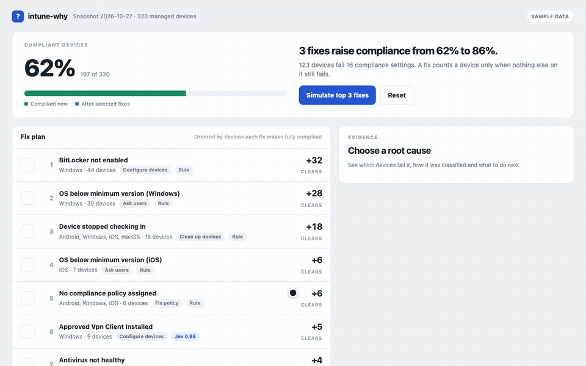

# intune-why

**Find the few fixes that clear most of your Intune noncompliance.**

Intune tells you that 123 devices are noncompliant. It does not tell you that fixing BitLocker clears 32 of them outright, that the Windows minimum OS version clears 28 more, and that 18 have simply stopped checking in. intune-why reads your compliance data from Microsoft Graph, groups every failing device by the setting that fails, and ranks the fixes by how many devices each one makes **fully** compliant.



```sh
pipx install git+https://github.com/dallascrilley/intune-why
intune-why demo            # opens the report for a fictional 320-device tenant
```

No dependencies beyond Python 3.9+, and no tenant needed for the demo.

## What you get

- **A fix plan, not a device list.** Each step picks the setting whose fix makes the most additional devices compliant. A device counts only when every failing setting on it is fixed, so the numbers match what Intune will report afterward.
- **A what-if view.** Tick fixes in the report and watch projected compliance update. One click simulates the top three.
- **Evidence for each root cause.** Affected devices and users, devices that also fail something else, devices that have not synced in 30 days, reported error text, and a next step.
- **A remediation path for every setting.** Built-in rules cover the standard Windows, iOS, Android and macOS compliance settings. Custom compliance settings, which can have any name, can go to an optional decision model (below).
- **Output that fits your workflow:** a terminal summary, a single self-contained HTML file, JSON, and a CSV of every affected device with its root cause for tickets or bulk actions.
- **Safe to share:** `--redact` swaps device and user names for pseudonyms so you can post a report in a ticket or an issue.

```text
intune-why  320 devices  62% compliant  123 need attention
3 fixes raise compliance from 62% to 86%.

  #  Root cause                              Devices  Clears  Compliant after  Action
  1  BitLocker not enabled                        44      32              72%  Configure devices (rule)
  2  OS below minimum version (Windows)           30      28              80%  Ask users (rule)
  3  Device stopped checking in                   18      18              86%  Clean up devices (rule)
  4  OS below minimum version (iOS)                7       6              88%  Ask users (rule)
  5  No compliance policy assigned                 6       6              90%  Fix policy (rule)
  6  Approved Vpn Client Installed                 5       5              91%  Configure devices (jev 0.95)
```

## Run it on your tenant

```sh
intune-why collect --tenant contoso.onmicrosoft.com --html report.html --open
```

`collect` signs you in with the device code flow, reads three collections from Microsoft Graph v1.0, writes `intune-snapshot.json` (mode 600), and prints the plan. It never writes to your tenant.

| Graph request | Permission (delegated, read-only) |
|---|---|
| `GET /deviceManagement/managedDevices` | `DeviceManagementManagedDevices.Read.All` |
| `GET /deviceManagement/deviceCompliancePolicySettingStateSummaries` | `DeviceManagementConfiguration.Read.All` |
| `GET .../deviceCompliancePolicySettingStateSummaries/{id}/deviceComplianceSettingStates` | `DeviceManagementConfiguration.Read.All` |

Sign-in uses Microsoft's public *Microsoft Graph Command Line Tools* client by default, the same one Graph PowerShell uses. Your tenant may require an admin to consent to these scopes once. To use your own app registration, pass `--client-id`. To bring your own token, pipe it in with `--token-stdin`; it is read from standard input so it stays out of shell history and process lists.

The token is held in memory, sent only to `graph.microsoft.com`, and never written to disk. Pagination links that point anywhere else are refused, and HTTP redirects are not followed. Throttled requests are retried using Graph's `Retry-After` header.

Analyze a saved snapshot again at any time, with different options:

```sh
intune-why analyze intune-snapshot.json --stale-days 45 --csv devices.csv --redact --html share.html
```

## Classifying custom settings with Jev

Standard compliance settings map cleanly to a remediation path. Custom compliance settings, such as `CustomCompliance.ApprovedVpnClientInstalled`, do not. For those, intune-why can ask [Jev](https://docs.typesafe.ai), a typed decision model from TypeSafe. It returns one of a fixed set of options with a probability for each, so it cannot invent a category.

```sh
export TYPESAFE_API_KEY=...
intune-why collect --tenant contoso.onmicrosoft.com --decide jev --html report.html
```

- **Rules run first.** Jev only sees settings that no rule matches.
- **Only the setting is sent:** its identifier, platforms, state counts and the share of devices that stopped syncing. Device names, user names and error text never leave your machine.
- **Low confidence goes to review.** Answers below 0.60 confidence are marked *Review*, with Jev's proposal shown alongside.
- **Measured before shipping.** In a shadow run against 40 labeled settings, every answer at or above 0.60 matched the label (33 of 33), and every disagreement fell below the floor. See [docs/decision-model.md](docs/decision-model.md) for the method, the misses and the limits.
- The model version is pinned (`jev-1.14.0`); set `INTUNE_WHY_JEV_MODEL` to try another and `INTUNE_WHY_DISABLE_JEV=1` to switch it off.

Without a key, custom settings appear as *Review* and everything else works the same.

## How to read the numbers

*Clears* is the number of devices that become fully compliant at that step of the plan, given the fixes before it. *Only this fails* counts devices for which this is the sole failing setting. Projections assume that fixing a setting resolves it on every affected device; devices that have stopped syncing will not report a fix until they check in, which the report calls out. Noncompliant devices that report no failing setting detail are listed separately and left out of the plan.

## Status

Version 0.1. The analysis, report and Graph client are covered by tests built on Microsoft's documented v1.0 response shapes, and the demo runs in CI on Python 3.9 and 3.13. The live collector follows the documented endpoints but has not yet been exercised across a broad range of production tenants. If you run it on yours, an issue with a `--redact`ed report, or just a note that it worked, is the most useful contribution you can make.

## Development

```sh
python -m pip install -e .
PYTHONPATH=tests python -m unittest discover -s tests
python scripts/make_demo.py              # regenerate the fictional tenant
python scripts/shadow_jev.py out.jsonl   # re-measure Jev (needs TYPESAFE_API_KEY)
```

MIT licensed.
